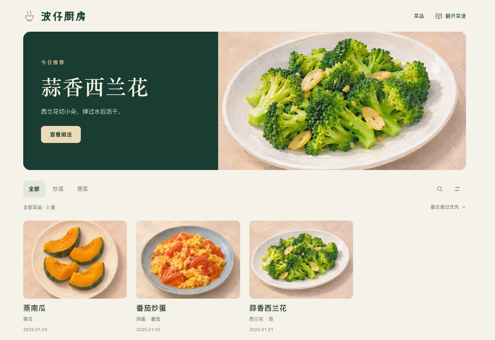
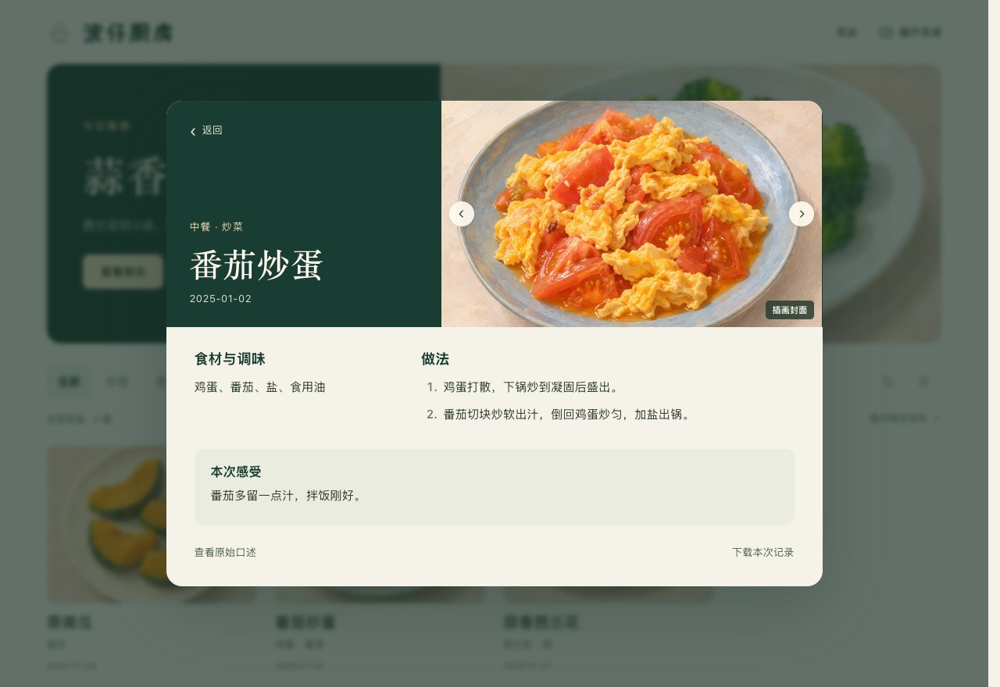
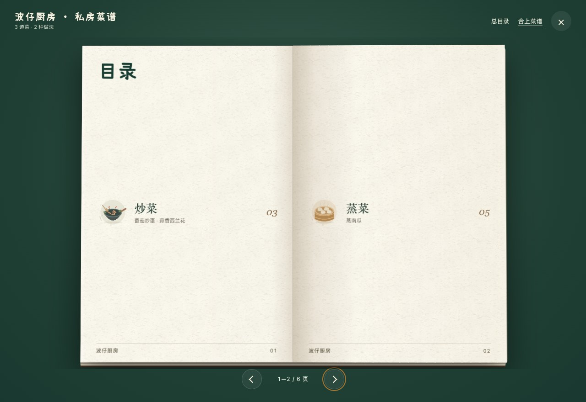

# 波仔厨房

如果你也喜欢下厨，大概遇到过这种时候。明明做过不少菜，一到饭点却想不起吃什么。想把上回那道特别好吃的菜再做一次，又忘了照的是哪份菜谱，自己改过哪一步

**波仔厨房是一本和 AI Agent 一起维护的个人菜谱。** 出锅拍张照，吃完聊几句做法和心得，就给这顿饭留了一页。下次翻着照片挑道菜，照着自己的版本再做一遍



## 先翻一翻示例

在 GitHub 点 **Code → Download ZIP**，解压后用浏览器打开 `outputs/波仔厨房-浅底插画首页.html`，就可以离线翻阅。里面有蒜香西兰花、番茄炒蛋和蒸南瓜三道示例，配图由 AI 生成 [查看示例菜谱](outputs/cookbook/README.md)

## 从今天做的第一道菜开始

打开能在电脑上处理文件的 AI Agent，比如 Codex、WorkBuddy、豆包工作或千问办公。把这个项目的链接和下面的话一起发给它，也可以直接交给它刚下载的项目压缩包

> 我想用波仔厨房记菜，帮我把项目下载到电脑上，按 README 准备好菜谱，完成后把能直接打开的首页发给我

如果 Agent 提示选文件夹，就选一个想长期存放菜谱的位置。首页准备好后，发一张自己的成品照，说说这次是怎么做的

> 这是今天做的葱油拌面。葱白先下锅，后来才放葱绿，最后加酱油拌面。吃着挺香，就是有点咸，下次酱油少放点，帮我记下来

不用特意摆盘，随手拍就行。Agent 能用生图工具时，会参考成品照画一张插画封面，原图也会留在这次做菜的记录里。记好后刷新首页，就能看到刚加的菜

## 平时可以怎么用

### 刚吃完，直接用语音说

打开语音输入，想到哪儿说到哪儿，漏了一步就补一句「对了，姜是最后放的」。Agent 会整理步骤、保存原话，碰到做菜日期或前后对不上的地方会找你确认 [菜谱维护规则](outputs/cookbook/MAINTENANCE.md)

### 到了饭点，让 Agent 帮你挑

> 今晚懒得想吃什么，从我做过的菜里抽三道，把每道要用的食材列一下，我看看冰箱里够做哪道

也可以告诉它家里还有什么菜，请它翻翻你的记录。想自己挑，就打开首页看「今日推荐」，或者按食材搜索、按做法筛选

### 又做了一次，两次都留着

> 今天又做了葱油拌面，这次少放了点酱油，咸淡刚好。帮我加一条复做记录，上次那条也留着

同一道菜可以存多次记录。点日期回看当次的食材、做法和心得，左右切换查看每次的成品照



### 有空就翻一翻菜谱书

点首页右上角的「菜谱」，从目录跳到想看的分类，再点菜名看做法。电脑上像翻双页书，手机上可以上下滑动。目录里的「主厨推荐」从全部菜品里挑，分类章节的推荐从对应分类里挑，刷新时重新抽选



## 菜谱是你的，Agent 可以换

照片、口述和菜谱存放在你电脑上的项目文件夹里。换一个 Agent，把原来的文件夹交给它，说一句「这是我的菜谱，读一下项目说明，接着帮我记菜」

换电脑时复制整个文件夹，就能把已有记录和维护规则一起带走。只想带一本成品去厨房，复制生成的离线 HTML 就够了

<details>
<summary>给 Agent 的准备与维护步骤</summary>

1. 优先打开用户已有的项目文件夹。首次使用时下载或解压本仓库，进入包含 `AGENTS.md` 的目录，阅读入口说明和 [菜谱维护规则](outputs/cookbook/MAINTENANCE.md)
2. 使用 Python 3.9 或更高版本。首次准备先安装依赖，再生成离线首页，之后更新菜谱只需运行两条构建命令

   ```sh
   python3 -m pip install -r requirements.txt
   python3 work/build_cookbook_demo.py
   python3 work/package_offline_demo.py
   ```

3. 在 `outputs/cookbook/dishes/` 为新菜分配下一个未使用的编号。初始示例库的第一道新菜用 `dish-004`，复做在同一道菜的 `attempts/` 下追加记录。成品照、口述原文和本次做法随记录保存，插画放在菜品目录的 `illustration.jpg` [菜品示例](outputs/cookbook/dishes/dish-001/recipe.md) · [记录格式](outputs/cookbook/dishes/dish-001/attempts/001/record.md) · [插画规范](outputs/cookbook/COVER_STYLE.md)
4. 向用户提供生成的首页路径。用户想去掉示例时，先确认移出的目录仅包含三道示例，再更新菜谱索引并重建网页。每次构建后打开首页，核对新菜的封面、日期和做法

想调整页面，可以从 `work/kitchen_*` 里的模板、样式和交互入手，然后运行 `python3 work/build_kitchen_redesign.py`。 [界面与构建说明](outputs/cookbook/DESIGN.md)

</details>
