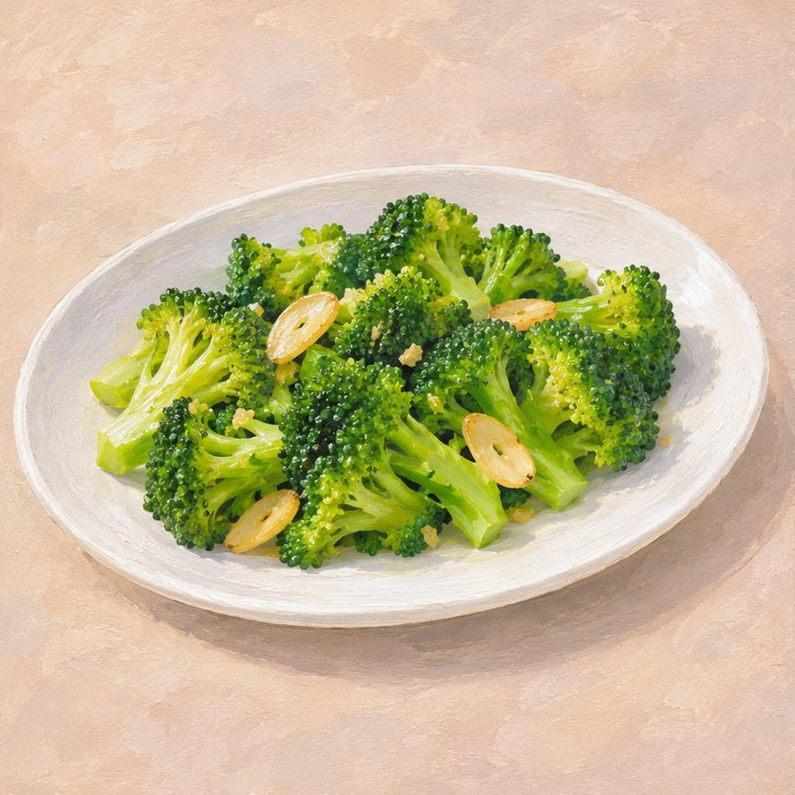

# 波仔厨房插画封面规范 · 清爽浅底版

以这张图为风格参考，换模型时仍使用同一张。本库另有插画偏好时，使用 `LOCAL_RULES.md` 中指定的样张。

## 一张封面的画法

| 要素 | 绘制标准 |
| --- | --- |
| 菜与盛器 | 从本菜实拍取食材、刀工、熟度、份量、器皿和摆盘，保留一两处最能认出这次下厨的特征。只画一份菜，桌面清空。 |
| 明暗与笔触 | 食材有清楚的固有色和干净的明暗层次。用轻薄细腻的水粉叠色，局部露出柔和笔痕，油润处点少量亮色。暗部保留色相，避免整幅灰褐、粗厚干刷或用颗粒滤镜制造手绘感。 |
| 背景与光 | 浅麦色、暖石灰或淡灰青，低饱和，桌面比菜安静。按菜色选底色，如金黄鸡皮配暖灰、淡黄蛋面配灰青。自然侧光，盘底有轻软接触阴影。 |
| 构图 | 横幅，以首页卡片的 4:3 裁切验收。视角随菜形与实拍选择，主要食材留在中央安全区域，保留盘缘与桌面的呼吸空间。做头图时另看宽幅裁切。 |
| 画面元素 | 画面内只有菜、盛器和桌面。省去桌布、筷勺、其他菜、文字、边框和水印。 |

## 可直接交给不同模型的提示词

上传两张参考图。第一张用本菜实拍，第二张用本库使用的样张。支持区分内容与风格输入的工具，将两张分别放在对应位置。只支持单图的工具优先传实拍，用下面的文字描述画风，再与样张并排校色。

> 画一张横幅私人食谱插画《{菜名}》。按图一画出{主要食材和可见特征}，保留{器皿与摆盘特征}。图二只参考上色、笔触、光线与完成度。食材清晰鲜亮，以轻薄水粉叠色表现体积，少量细腻可见的笔痕，油润处有节制地点亮。单份菜置于{按食材选定的浅色低饱和桌面}，自然侧光，柔软盘底阴影。选取{最能看清主料的视角}，画面可裁成 4:3 缩略图。请省去其他菜、桌布、筷勺和文字。避免整图发黄、灰雾、厚重干刷、塑料高光和通幅颗粒。

填括号时只用本菜照片和做菜记录可支持的信息。样张中的食材与餐盘纹样只属于样张。模型的种子、风格代码、参考权重不作为跨模型规范。

## 验收与入库

1. 将生成图与实拍并排，看主要食材、熟度和器皿是否对得上。有额外配菜或装饰时，回到实拍修正。
2. 将生成图缩到约 160 像素宽，与样张并排。先看到菜，再注意到桌面，食材亮部清楚，盘底有重量。偏灰时只调整食材中间色与阴影；背景抢眼时只调桌面，保留食材鲜度。
3. 检查桌面和手机卡片实际裁切。通过后导出 RGB JPEG，长边约 1100 像素，质量约 88–90，存为本菜目录下的 `illustration.jpg`。原始照片仍在对应的 `attempts/` 记录中。
